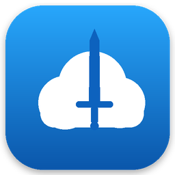
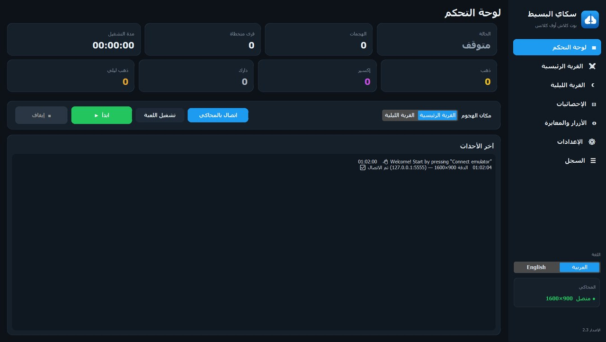
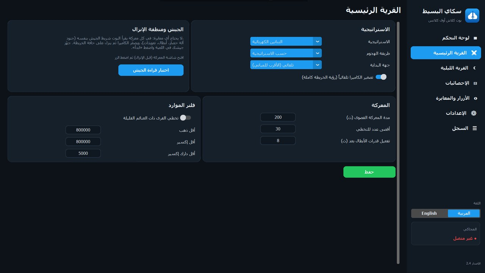
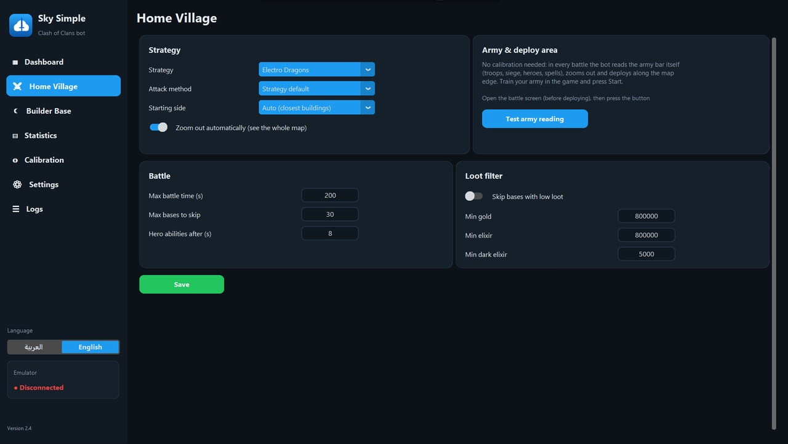
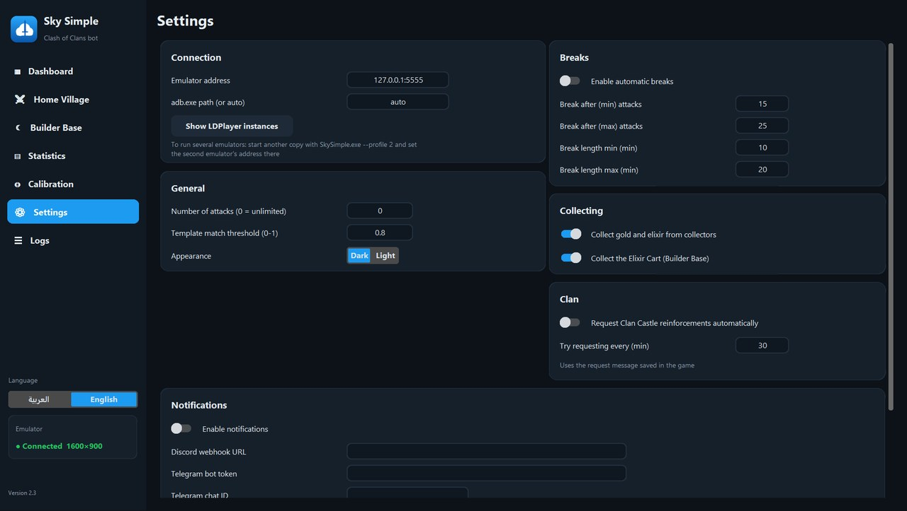
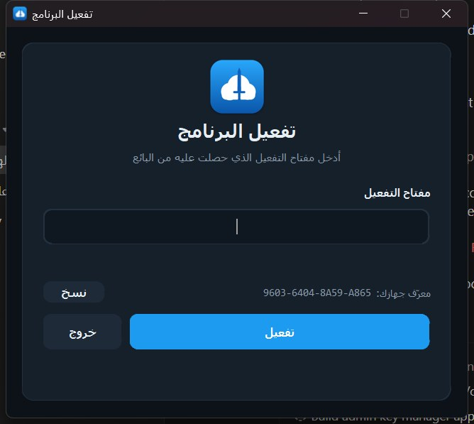
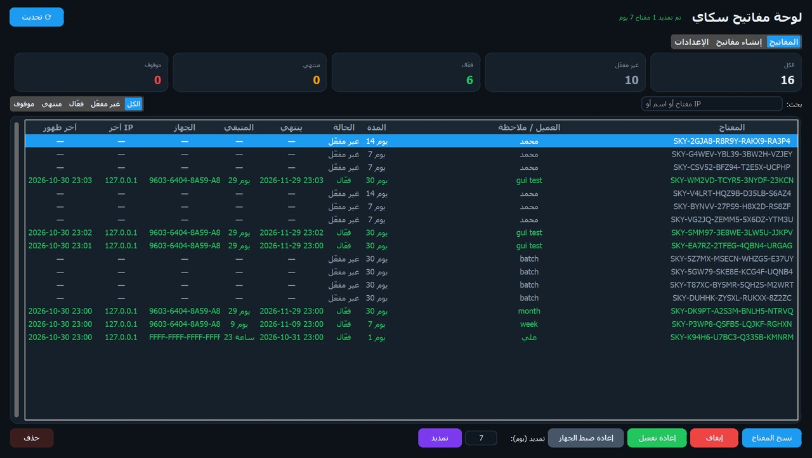

<div align="center">



# SkySimple — سكاي البسيط

**بوت ذكي لـ Clash of Clans على محاكي LDPlayer، بواجهة عربية وإنجليزية ونظام اشتراكات متكامل**

*A smart Clash of Clans automation bot for LDPlayer — Arabic & English UI, with a built-in license key system*


[المزايا](#-المزايا) · [لقطات الشاشة](#-لقطات-الشاشة) · [التشغيل](#-التشغيل) · [نظام التفعيل](#-نظام-التفعيل) · [البنية](#-بنية-المشروع) · [English](#english)

</div>

---

## ✨ المزايا

### ⚔️ القرية الرئيسية
| | |
|---|---|
| **بلا أي إعداد** | يقرأ شريط الجيش بنفسه في كل معركة (جنود، آلة حصار، أبطال، تعويذات) وينزل كل شيء: درّب جيشك واضغط «ابدأ» |
| **4 استراتيجيات** | ذكي (يناسب أي جيش)، التنانين الكهربائية (جهة مركّزة)، التنانين (جهتان)، العفاريت المتسللة (ثلاث جهات سريعة) |
| **4 طرق هجوم** | جهة واحدة، جهتان، ثلاث جهات، أو من كل الجهات، مع اختيار جهة البداية تلقائياً حسب كثافة المباني |
| **إنزال ذكي** | تعويذات موجّهة نحو المركز، أبطال وقدرات بتوقيت، وإعادة إنزال أي جندي متبقٍ |
| **قراءة الغنائم** | قارئ أرقام مدمج (بدون Tesseract) لتخطي القرى الفقيرة حسب الحد الذي تختاره |
| **تصغير تلقائي** | يصغّر الكاميرا لرؤية الخريطة كاملة، فتبقى منطقة الإنزال ثابتة ولا تحتاج معايرة |
| **أي دقة 16:9** | 1600×900 أو 1280×720 أو 1920×1080: يحوّل الإحداثيات تلقائياً |

### 🌙 القرية الليلية
- هجمات بمرحلتين مع تمييز تلقائي لبداية كل مرحلة.
- جمع عربة الإكسير وفقاعات المجمّعات.
- تنقّل تلقائي بالقارب بين القريتين، حتى لو كانت الكاميرا بعيدة أو مبنى محدداً.

### 🤖 الأتمتة والموثوقية
- **طلب تعزيزات الكلان** تلقائياً كل فترة تحددها.
- **تعافٍ ذاتي**: إعادة تحميل اللعبة عند الانقطاع، إغلاق النوافذ المنبثقة، الخروج من الشاشات العالقة، وإعادة الاتصال بالمحاكي.
- **فترات راحة** دورية قابلة للتخصيص.
- **أكثر من محاكٍ**: `SkySimple.exe --profile 2` لكل محاكٍ بإعدادات وإحصائيات مستقلة.

### 📊 المتابعة
- **إحصائيات** لكل هجوم: الذهب والإكسير والدارك، المجموع، والمعدل في الساعة.
- **إشعارات** على Discord (Webhook) و Telegram عند كل هجوم أو خطأ أو توقف.

### 🎨 الواجهة
- عربية كاملة من اليمين لليسار، وإنجليزية بضغطة زر.
- مظهر داكن وفاتح.
- ملف تنفيذي واحد، لا يحتاج تثبيت Python عند المستخدم.

---

## 🖼️ لقطات الشاشة

<table>
<tr>
<td width="50%"><p align="center">لوحة التحكم</p></td>
<td width="50%"><p align="center">الاستراتيجيات ومسح الجيش</p></td>
</tr>
<tr>
<td width="50%"><p align="center">English interface</p></td>
<td width="50%"><p align="center">Settings</p></td>
</tr>
<tr>
<td width="50%"><p align="center">نافذة التفعيل</p></td>
<td width="50%"><p align="center">لوحة إدارة المفاتيح (SkyAdmin)</p></td>
</tr>
</table>

---

## 🚀 التشغيل

### المتطلبات
- Windows 10 أو 11
- [LDPlayer 9](https://www.ldplayer.net/) بدقة **1600×900**، مع تفعيل **ADB debugging: Open local connection** من الإعدادات ← أخرى
- للتشغيل من الكود: Python 3.12

### للمستخدم
فك ضغط النسخة في مسار قصير مثل `C:\SkySimple`، شغّل `SkySimple.exe`، أدخل مفتاح التفعيل، ثم «اتصال بالمحاكي» ← «ابدأ».

### من الكود المصدري
```bash
cd SkySimple
python -m venv .venv
.venv\Scripts\pip install -r requirements.txt
.venv\Scripts\python app.py
```
> تشغيل البوت من الكود لا يطلب تفعيلاً. لربطه بخادم أثناء التطوير ضع `license_server.json` بجانب `app.py`:
> `{"url": "https://xxxx.supabase.co", "key": "sb_publishable_..."}`

### البناء
```bash
cd SkySimple
.venv\Scripts\python -m PyInstaller --noconfirm --onefile --windowed --name SkySimple ^
  --icon assets\icon.ico --add-data "assets;assets" --collect-data customtkinter app.py

cd ..\SkyAdmin
..\SkySimple\.venv\Scripts\python -m PyInstaller --noconfirm --onefile --windowed --name SkyAdmin ^
  --add-data "setup.sql;." --paths ..\SkySimple --hidden-import bot.license ^
  --collect-data customtkinter admin.py
```

---

## 🔑 نظام التفعيل

```
┌──────────────┐   activate_license(key, device)   ┌──────────────────┐   service key   ┌──────────────┐
│ SkySimple.exe│ ────────────────────────────────▶ │  Supabase (SQL)  │ ◀────────────── │ SkyAdmin.exe │
│  (العميل)    │ ◀──── ok / expired / revoked ──── │  licenses table  │  إنشاء · إيقاف  │   (البائع)   │
└──────────────┘      كل 30 دقيقة                  └──────────────────┘  تمديد · حذف    └──────────────┘
```

- **مدد مرنة**: يوم، أسبوع، شهر، أو عدد أيام مخصص. المدة تبدأ عند التفعيل لا عند الإنشاء.
- **ربط بالجهاز**: أول جهاز يفعّل المفتاح يُربط به عبر بصمة (معرّف Windows + اللوحة الأم + قرص النظام)، فلا يمكن مشاركته أو إعادة بيعه. تغيّر الـIP لا يؤثر.
- **تحكم كامل من SkyAdmin**: إيقاف وإعادة تفعيل، إعادة ضبط الجهاز، تمديد، حذف، وبحث بالمفتاح أو اسم العميل أو الـIP، مع عرض آخر ظهور وآخر IP لكل عميل.
- **أمان**: الجدول محمي بـ Row Level Security. نسخة العميل تحمل المفتاح العام فقط، ولا تستطيع إلا استدعاء دالة التفعيل. المفتاح السري يبقى على جهاز البائع.
- **نسخة العملاء**: زر في SkyAdmin يختم `SkySimple.exe` بعنوان الخادم ويصدّر ZIP جاهزاً للإرسال، بلا أي كود.

الإعداد مرة واحدة: أنشئ مشروع Supabase مجانياً، شغّل [`SkyAdmin/setup.sql`](SkyAdmin/setup.sql) في SQL Editor، ثم الصق رابط المشروع والمفتاحين في إعدادات SkyAdmin. الخطوات كاملة في [دليل البائع](SkyAdmin/دليل%20البائع.txt).

---

## 🗂️ بنية المشروع

```
SkySimple/                  البوت
├── app.py                  الواجهة (customtkinter): الصفحات، الإعدادات، نافذة التفعيل
├── bot/
│   ├── adb.py              الاتصال بالمحاكي: لقطات خام سريعة، نقر، سحب، وتحويل أي دقة إلى 1600×900
│   ├── touch.py            تكبير وتصغير بإصبعين عبر sendevent
│   ├── vision.py           مطابقة القوالب متعددة المقاييس (OpenCV)
│   ├── ocr.py              قارئ أرقام الغنائم
│   ├── army.py             قراءة شريط الجيش في كل معركة ومعرفة نوع كل خانة
│   ├── strategy.py         الاستراتيجيات وطرق الهجوم واختيار الجهة
│   ├── deploy.py           تنفيذ الإنزال
│   ├── farm.py             حلقة القرية الرئيسية والتعافي من الأخطاء
│   ├── builder.py          القرية الليلية
│   ├── clan.py             طلب التعزيزات
│   ├── notify.py           Discord و Telegram
│   ├── license.py          التحقق من المفتاح وبصمة الجهاز
│   ├── config.py           الإعدادات الافتراضية والحفظ الآمن
│   └── i18n.py             الترجمة العربية والإنجليزية
├── templates/              صور الأزرار وقالب الأرقام
└── assets/                 الشعار والأيقونة

SkyAdmin/                   لوحة البائع
├── admin.py                الواجهة: المفاتيح، الإنشاء، الإعدادات، نسخة العملاء
├── supa.py                 واجهة Supabase REST
├── setup.sql               الجدول ودوال التفعيل والتمديد
└── دليل البائع.txt
```

---

## ⚠️ تنبيه

استخدام برامج الأتمتة يخالف شروط خدمة Supercell وقد يؤدي إلى حظر الحساب. المشروع مقدّم كما هو، واستخدامه على مسؤوليتك. هذا المشروع غير تابع لـ Supercell ولا مدعوم منها.

---

<a name="english"></a>
## English

**SkySimple** is a Clash of Clans automation bot for the LDPlayer Android emulator, written in Python with OpenCV and a customtkinter desktop UI in Arabic (RTL) and English.

**Highlights**
- **Home Village** — zero setup: the bot reads the army bar itself in every battle (troops, siege, heroes, spells). 4 strategies (Smart for any army, Electro Dragons, Dragons, Sneaky Goblins) × 4 attack methods, targeted spells, timed heroes and abilities, loot filtering with a built-in digit reader, automatic zoom-out with a fixed deploy area (no calibration), and support for any 16:9 resolution.
- **Builder Base** — two-stage attacks, Elixir Cart and collector collection, automatic boat travel.
- **Automation** — clan reinforcement requests, self-recovery (reloads, popups, stuck screens, ADB reconnects), scheduled breaks, multi-emulator profiles.
- **Tracking** — per-attack statistics and Discord / Telegram notifications.
- **Licensing** — Supabase-backed keys (day / week / month / custom) bound to the first device that activates them, revalidated every 30 minutes, and managed from the **SkyAdmin** desktop app (revoke, reset device, extend, delete, export a stamped client build).

**Run from source:** `cd SkySimple`, create a venv, `pip install -r requirements.txt`, then `python app.py`. LDPlayer must run at 1600×900 with local ADB enabled.

**Licensing setup:** create a free Supabase project, run [`SkyAdmin/setup.sql`](SkyAdmin/setup.sql) in the SQL Editor, then paste the project URL, publishable key and secret key into SkyAdmin → Settings.

> Using automation tools violates Supercell's Terms of Service and may result in an account ban. Not affiliated with or endorsed by Supercell.
